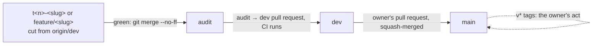

# Contributing

For people working on TRELLIS. Agent-driven work follows the same rules
through `docs/BUILD_SYSTEM.md`; this file is the human route through them.
`CLAUDE.md` is the authority on conventions and wins any disagreement with
this file.

## Setup

### Rust

`rust-toolchain.toml` pins **1.93.0** with the `rustfmt` and `clippy`
components, and rustup installs it on the first cargo command in the
checkout. Do not build with another toolchain and compare results: the
`Verdict` seal's compile-fail fixtures in `crates/trellis-checks/tests/forge/`
passed on 1.93 and failed on 1.95, because the two emit different macro
backtrace notes (see the comment in `rust-toolchain.toml`).

### External tools the tests and gates use

| Tool | Needed for | Where it is pinned or named |
|---|---|---|
| git | everything; tests build fixture repositories | — |
| Python 3, with `mypy` and `pytest` | the default checks (`mypy --no-incremental`, `pytest -q`) and the guard suite fixture; CI uses Python 3.11 | `qa/requirements-ci.txt` (hashed: mypy 2.3.1, pytest 9.1.1); `dist/QUICKSTART.md` "What it needs" |
| a model runtime on `127.0.0.1:11434` (Ollama) | G2b, `scripts/gates/guards.sh`, which probes `/api/tags` | `docs/BUILD_SYSTEM.md` "Gates"; CI substitutes a plain listener and runs `qa/run-guards.py` directly |
| `cargo-deny`, `cargo-audit` | G5 and the lockfile rule | CI installs `cargo-deny` 0.20.2 and `cargo-audit` 0.22.2 (`.github/workflows/ci.yml`, `supply-chain` job) |
| `gitleaks` | G5 and the pre-commit hook; G5 fails when it is absent | CI pins 8.21.2 by checksum |
| `zizmor` | G5 and the pre-commit hook, for workflow changes | `.github/requirements-zizmor.txt` (1.30.1, hashed) |
| `actionlint` | the pre-commit hook, for workflow changes | — |
| `gh` (authenticated) | G0, G6, `scripts/tickets/next.sh`, and every `trellis-tickets` command that reads issues | — |
| `pyright-langserver` | only if you work on the opt-in Pyright backstop (`[index] backstop = "pyright"`, ADR 0031) | — |
| WebKitGTK 4.1 dev packages (Linux) | only for `desktop/` | the `desktop` job in `ci.yml` |

Install the hooks once per clone: `scripts/hooks/install.sh`. It installs
`pre-commit` (secret and workflow checks) and `pre-push` (refuses pushes to
`main` and of `v*` tags) into the shared git directory, so worktrees get
them too.

### Two host rules from `CLAUDE.md`

- **One cargo process at a time.** The owner's host has 15 GB shared with a
  local model, and parallel builds have been killed for memory. Do not run
  `cargo test` in one terminal while `cargo build` runs in another, and do not
  start a second while an agent is compiling.
- **On Windows, run the gates from Git Bash, not WSL.**

## Build, test, lint, format

```
cargo build --workspace
cargo test  --workspace
cargo clippy --workspace --all-targets
cargo fmt --all
```

CI passes `--locked` to each, and so should you before pushing. G3 runs
clippy with `-D warnings` and fails on any `#[allow(` the change adds. The
local-only binary is checked separately:
`cargo build -p trellis-cli --no-default-features` (ADR 0024). Every other
command is in `docs/COMMANDS.md`.

**Run tests with `RUST_BACKTRACE` unset or `0`.** With `RUST_BACKTRACE=1`,
anyhow appends a backtrace to the CLI's error output, and
`no_model_message_is_the_same_from_run_and_from_bare_trellis_on_a_pipe` in
`crates/trellis-cli/tests/cli/user_dir.rs` fails, because it requires the text
`trellis run` prints to appear whole in what bare `trellis` prints.

`qa/run-guards.py` runs whichever `trellis` is first on `PATH`; put
`target/debug` first, or the guards test an old binary.

The gates run everything above and more, in order, stopping at the first
failure: `scripts/gates/run-all.sh [<issue>]`, or `--only <id>` for one. The
gate table is in `docs/BUILD_SYSTEM.md` "Gates". A gate that cannot run fails;
there is no skip.

## Branches

From `CLAUDE.md` and ADR 0051:

1. Cut `feature/<slug>` or `t<n>-<slug>` (for issue `n`) from `origin/dev`.
2. When it is green, it is merged into `audit` with `git merge --no-ff`.
3. `audit` is promoted into `dev` by an `audit → dev` pull request; CI runs
   on it.
4. `dev` reaches `main` only by the owner's pull request, squash-merged.



**Never push `main` or a `v*` tag.** The pre-push hook refuses both; tags are
the owner's act (`docs/BUILD_SYSTEM.md`, "Versions and releases"). The only
permanent branches are `main`, `dev` and `audit`; delete yours after it
merges.

## Tickets

Work is tracked as GitHub issues, labelled by the ticketing standard in
`docs/TICKETING.md`. The short version:

- Labels are dimensions with one value each: `area:`, `kind:`, `risk:`,
  `surface:`, `effort:`, `origin:`, plus flags such as `!agent-ok` and
  `!needs-adr`.
- Triage is deterministic rules, not a model call, and a rule that cannot
  decide marks `triage:needs-human` rather than guessing.
- A ticket is workable when G0 passes: it is open, has `## Done when` and a
  fenced `## Verify`, and is not blocked, needs-human or split. It is done
  when every gate exits 0, including G6, which runs its Verify command.

The rules are implemented in `crates/trellis-tickets` as a separate binary,
so the `trellis` CLI does not grow (ADR 0040):

```
cargo run -p trellis-tickets -- triage <n>            # one issue's labels, each with its rule
cargo run -p trellis-tickets -- ready <n>             # G0's checks and the named extras
cargo run -p trellis-tickets -- new --title <t> --body-file <p> --dry-run
```

`sweep`, `scan` and `index` are listed in `docs/COMMANDS.md`.

## What review checks

Review fails a change that breaks any of these, however good the reason.

- **The ADR-guarded rules.** The ten in `CLAUDE.md`, "Rules that need an ADR
  to change", and the invariants in "Invariants the PR #1 review rounds put in
  place". `docs/ARCHITECTURE.md` lists each with its ADR and the test that
  holds it. Read the ADR before touching any of them.
- **Crate boundaries.** `trellis-index` and `trellis-vault` must never depend
  on `trellis-model`; `trellis-checks` owns `Verdict` (`CLAUDE.md`, "Crate
  boundaries are load-bearing").
- **A new crate dependency needs an ADR** (`CLAUDE.md`, "Dependency
  pinning"). Requirements use caret form (`"1.2"`), not `=` pins.
- **The lockfile.** `Cargo.lock` is committed and is the pin. A lockfile
  update is its own commit, and `cargo deny check` and `cargo audit` both
  pass on it. `tree-sitter` and `tree-sitter-python` move together (0.27.0 /
  0.25.0, asserted by `crates/trellis-index/tests/grammar_abi.rs`).
  `bincode` 3.0.0 deliberately fails to compile; the workspace uses
  `postcard`.
- **No measurement without its method.** A figure in a document carries its
  method beside it. If it cannot be measured yet, write "pending" and name
  the milestone (`CLAUDE.md`, "Before claiming a number").
- **Style.** `thiserror` in libraries, `anyhow` in binaries. `tracing` for
  instrumentation; it is also the budget accounting, so do not add a second
  telemetry path (ADR 0008). Comments explain why, not what. Tests assert
  behaviour and name the risk they defend. No marketing language in code,
  comments, docs or CLI output.
- **No stubs.** G4 fails on `TODO`, `FIXME`, `todo!`, `unimplemented!` and
  mock markers in production lines the change adds. A command that appears
  to work without doing the work is worse than one that says it is not built.

## How to

Each checklist was built by following an existing case through the code.
Line numbers drift; search for the names.

### Add a built-in tool to the agent loop

Followed from `coverage_report`, the most recent built-in. A new tool needs
an ADR if it widens what a model can do (ADR 0023 §2 is the precedent), and
it must not return a correctness claim: only `ToolResult::Checks` can
(rule 2).

1. `crates/trellis-loop/src/agent.rs`: add a `ToolCall` variant, and an arm in
   `render` if its result needs its own rendering.
2. `crates/trellis-loop/src/wire.rs`: add the `ToolCallWire` variant (it
   derives the JSON Schema a constrained runtime is given) and its arm in
   `ToolCallWire::into_step`. Add the name to the list in
   `the_schema_names_every_tool`.
3. `crates/trellis-loop/src/registry.rs`: append the name to `BUILTIN_TOOLS`
   (after the existing ones: the first five are the measured prompt's order);
   add it to `OPT_IN` unless it should be on by default (`DEFAULT_ON` changes
   the measured prompt, so that needs a reason); add its arguments to
   `args_hint`; add its arm to `call_json`.
4. `crates/trellis-loop/src/gate.rs`: add the name to `APPROVABLE_TOOLS` and
   to `READ_ONLY_TOOLS` with whether it only reads; add arms to `tool_name`
   and `label`.
5. `crates/trellis-loop/src/orchestrator.rs`: add an arm to `may_change_tree`
   and the dispatch arm in `run_gates_and_tool`'s `match &call`.
6. `crates/trellis-loop/src/adapter.rs`: if the observation carries coverage,
   add it to `carries_coverage`, so it is never cut to fit (ADR 0033 §2).
7. `crates/trellis-cli/src/run_cmd.rs`: add an arm to `action_from`, which
   records the call in the trail.
8. Tests beside the tool, in the style of `crates/trellis-loop/src/graph_tools.rs`
   (opt-in refusal, behaviour) and `registry.rs`
   (`callers_of_and_callees_of_are_opt_in_and_leave_the_measured_prompt_unchanged`).

Most of these are exhaustive `match`es, so the compiler finds the ones you
miss; the name lists (`BUILTIN_TOOLS`, `OPT_IN`, `APPROVABLE_TOOLS`,
`READ_ONLY_TOOLS`, `args_hint`) it does not, and tests in `registry.rs` and
`gate.rs` hold some of them.

### Add a check kind in `trellis-checks`

Followed from `CheckKind::Import`. A check kind produces `Verdict`s, so the
change is to the grounding contract's surface; expect review to ask for an
ADR, and never add a constructor that does not take a `ProcessOutput`
(rule 1).

1. `crates/trellis-checks/src/verdict.rs`: add the `CheckKind` variant, its
   name in `check_kind_name`, and a `pub(crate) fn from_<kind>(o: ProcessOutput)`
   constructor calling `from_output`.
2. `crates/trellis-checks/src/lib.rs`: add the public entry point that runs
   the process and returns `Verdict::from_<kind>(...)`, as `import_check`
   does, and any configuration it needs in `CheckConfig`.
3. `crates/trellis-loop/src/wire.rs`: add it to `CHECK_KINDS` (the parser
   matches on it) and to the error text in `into_step`.
4. `crates/trellis-loop/src/orchestrator.rs`: add the arm in `run_checks`.
5. `crates/trellis-loop/src/adapter.rs`: the two prompt lines that read
   "`kinds` are any of: typecheck, tests, import, governance".
6. Run the compile-fail proof: `crates/trellis-checks/tests/seal.rs`.

### Add a CLI command

**The `trellis` CLI surface is fixed by brief 4.12** (`docs/BRIEF.md`) and
grows only by an owner-directed ADR (`CLAUDE.md`, "Commands"). Without that
ADR, do not start. Tooling that is not product surface goes elsewhere: the
ticketing commands became a separate binary for exactly this reason
(ADR 0040). With the ADR:

1. `crates/trellis-cli/src/main.rs`: a variant of `enum Command` and its arm
   in the `match command` dispatch. Decide whether it needs a repository
   (`needs_repo`) and whether `--json` applies to it.
2. The implementation in its own module under `crates/trellis-cli/src/`,
   declared in `main.rs`.
3. `docs/COMMANDS.md`: one line with the ADR that added it.
4. `crates/trellis-cli/tests/cli/`: tests that run the binary, one module per
   command, declared in its `main.rs`.

### Add a queue routine or an agent profile

These are repository files, not code.

- **Profile:** `.trellis/agents/<name>.toml`, fields as `ProfileFile` in
  `crates/trellis-queue/src/profile.rs`; unknown keys are refused. Start from
  `examples/agents/` (copy the directory's contents into `.trellis/agents/`).
  A `command = [...]` profile is a process agent and needs `trellis trust`
  (ADR 0026 §11).
- **Routine:** `.trellis/routines/<name>.toml`, fields as `RoutineFile` in
  `crates/trellis-queue/src/routine.rs`; the annotated example is in
  ADR 0026 §7.
- Check either with `trellis agents list` or `trellis routines list`, which
  validate the whole set (`crates/trellis-cli/src/orchestrate.rs`).
- Profiles and routines are committed files, so they need a clean commit
  before `trellis work` will run (ADR 0009).

## Where to start reading

A first week, in order:

1. `docs/MISSION.md`: what the project is for, and which goals are not
   delivered.
2. `docs/ARCHITECTURE.md`: the crates and one run through the code.
3. `docs/GLOSSARY.md`: keep it open.
4. `CLAUDE.md`: the rules review holds you to.
5. ADRs, in this order: 0004 (grounding contract), 0005 (loop shape), 0002
   and 0014 (edge confidence and radius coverage), 0009 (clean worktree),
   0007 (trail), 0023 and 0032 (trust and the throwaway clone), 0051
   (branches). The full list is `docs/adr/README.md`.
6. Four files, read in this order:
   - `crates/trellis-checks/src/verdict.rs`: short, and the whole grounding
     contract is visible in it.
   - `crates/trellis-loop/src/tools.rs`: what the model gets back, and why
     there is no pass variant.
   - `crates/trellis-loop/src/agent.rs`, `run_seeded`: the loop. The
     `Step::Done` arm is the architecture.
   - `crates/trellis-cli/src/run_cmd.rs`, `run_body` from the snapshot to the
     end, then `record_trail`: what happens around the loop.

`docs/STATUS.md` is long (over 2,000 lines) and is the audited record of what
is built and what is not. Do not read it front to back. Read its summary at
the top and "Next, in order", then search it for the crate, command or ADR
you are about to touch before you change anything; it often records why
something is the way it is.
