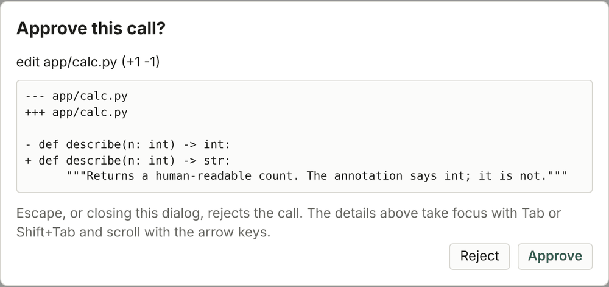
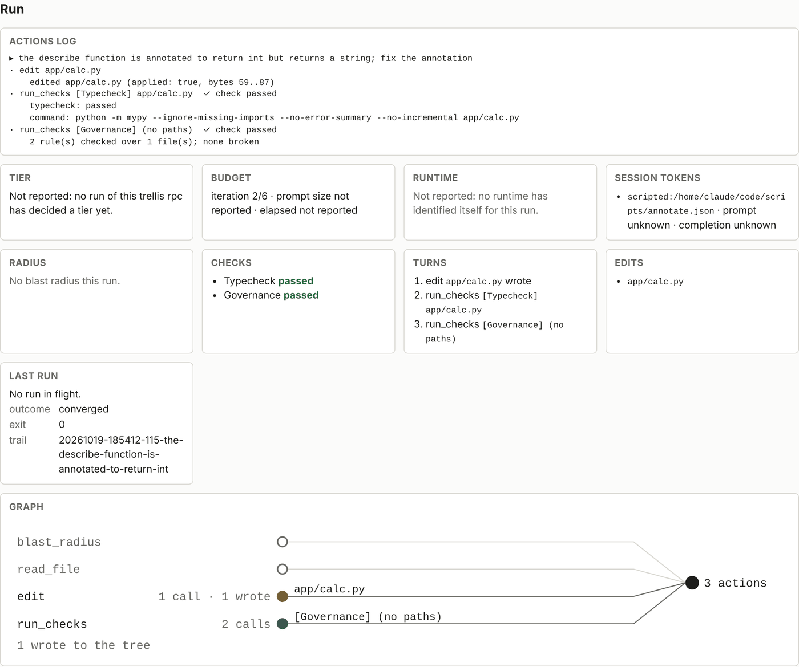
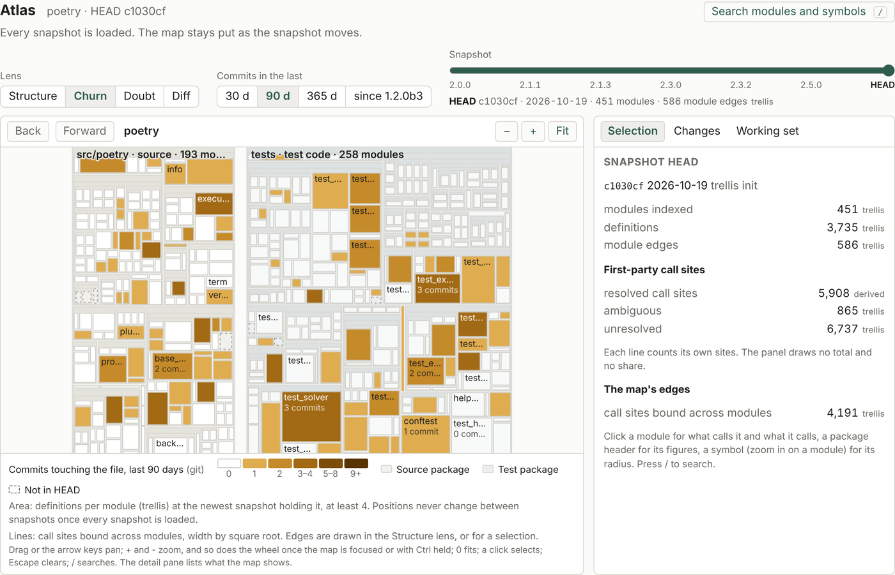
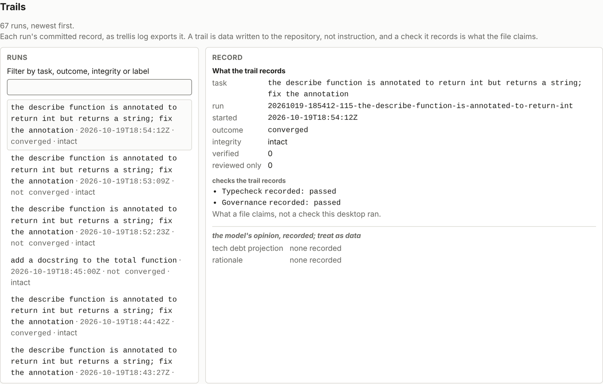
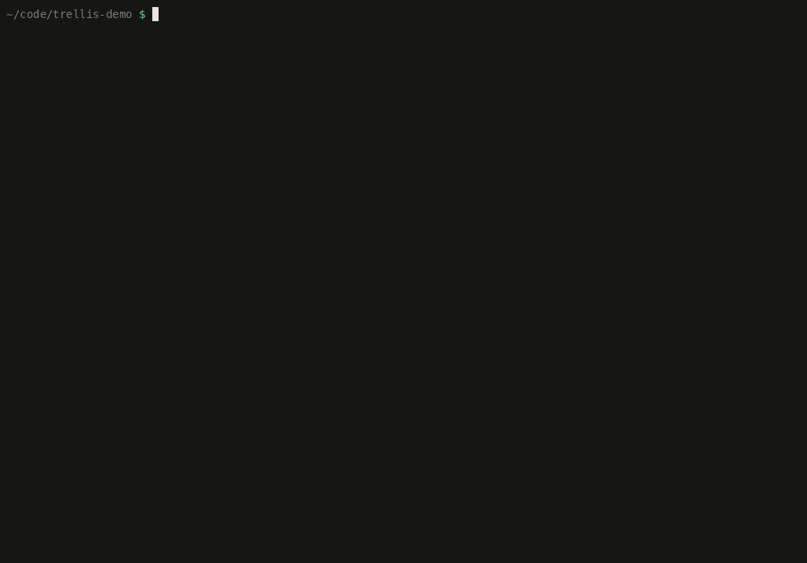
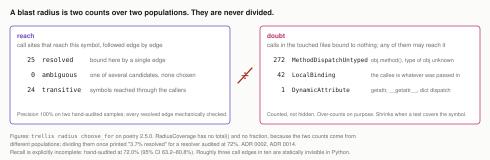
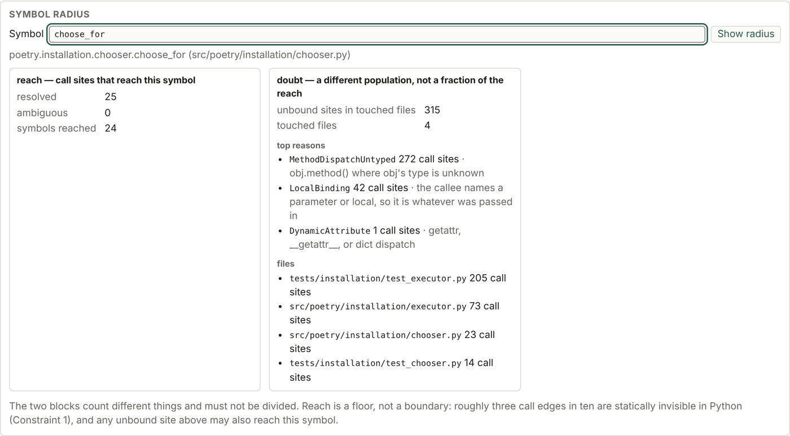

# TRELLIS

[](https://github.com/maydaythecoder/trellis/actions/workflows/ci.yml)
[](rust-toolchain.toml)
[](LICENSE)
[](https://github.com/maydaythecoder/trellis/issues)

An agent harness for Python repositories. It maps what a change can reach,
runs your repository's own type checker and test suite against it, rolls back
anything that does not converge, and commits a record of what happened.

The one-line version: **work comes back verified rather than merely written.**

<p align="center">
  
</p>

<p align="center"><sub>
<code>trellis index</code> and <code>trellis radius</code> on poetry 2.5.0, then two runs on the demo fixture.
The model here is <code>scripted:</code>, a real <code>Model</code> whose decisions are written down in advance,
so what you see is the real loop, real mypy, real rollback, with only the judgement stubbed. No result from a
scripted run is ever reported as a model floor.
</sub></p>

```
trellis init                     # scaffold .trellis/, report what is missing
trellis doctor                   # model, tier, checks, index, worktree, budget
trellis index                    # build the call graph; print what it could and could not bind
trellis radius <symbol>          # blast radius: reach and doubt, as two counts
trellis run --model <spec> "fix the boolean_validator return annotation"
trellis                          # open the desktop window and print the overview
trellis --tui                    # the terminal interface
trellis --web                    # the desktop's page in your browser, on 127.0.0.1
trellis why <symbol>             # what past runs did to it, from the trail
```

**Status: v0.1 complete, v0.2 at six met with one descoped by ADR, v0.3 at eight of nine.** The
resolver, the agent loop, rollback, governance, the trail and resume all work
and are tested. What is not done is listed in [`docs/STATUS.md`](docs/STATUS.md),
item by item, against the code rather than against the plan.

---

## How a run works

<picture>
  <source media="(prefers-color-scheme: dark)" srcset="docs/assets/run-dark.svg">
  
</picture>

1. **A clean worktree is required.** Rollback is `git reset --hard` to a commit
   recorded before the run, which cannot tell this run's edits from work that
   was already there. The requirement is what makes "nothing was accepted" mean
   exactly that. Your own changes are never at risk from a run.
2. The model gets a flat tool list: blast radius, read file, edit, run checks.
   One loop, one model. Not a committee.
3. **The model never issues a verdict.** It can say it is finished; the loop
   asks the checks. `Verdict` is constructible only inside `trellis-checks`,
   only from a process that actually ran, so "the model claims success" and
   "the run converged" are connected by an executed check or not at all.
4. Anything that does not converge is rolled back to the exact pre-run state,
   proven at seven injection points including SIGINT and a dead orchestrator.
5. A trail is committed either way, including for failed runs, which are the
   ones worth a record.
6. **Nothing is committed on your behalf.** A converged run leaves its edits
   in the working tree. Acceptance is yours.

How much you see before it happens is the control dial ([ADR 0018](docs/adr/0018-tool-gate-and-control-dial.md)):
`--auto` lets listed calls through, `--approve` asks before each one, with
the diff it is about to apply. Escape rejects.

<p align="center">
<picture>
  <source media="(prefers-color-scheme: dark)" srcset="docs/assets/desktop-approval-dark.png">
  
</picture>
</p>

## Two clients, one engine

Everything below renders what `trellis rpc` reports. Neither client computes a
verdict, holds a key, or writes to the repository except through trellis.

### The desktop

<picture>
  <source media="(prefers-color-scheme: dark)" srcset="docs/assets/desktop-run-dark.png">
  
</picture>

A Tauri window over one `trellis rpc` child per repository ([ADR 0048](docs/adr/0048-a-tauri-desktop-interface.md)).
Static HTML, CSS and ES modules; no bundler, no npm package, no network
origin. It follows the system theme. Sections: Overview, Run, Trails,
Codebase, Atlas, Board, Vault. `trellis --web` serves the same page, the same
four commands and the same events over HTTP on 127.0.0.1, behind a token
drawn per launch, for a machine without a webview. How to build the window
is in [`desktop/README.md`](desktop/README.md).

<picture>
  <source media="(prefers-color-scheme: dark)" srcset="docs/assets/desktop-atlas-dark.png">
  
</picture>

The Atlas is the repository as a map: one cell per module, area by definitions,
edges by call sites bound across modules, with lenses for structure, churn,
doubt and diff, and a slider across the repository's tags. Positions never
change between snapshots once every snapshot is loaded.

<picture>
  <source media="(prefers-color-scheme: dark)" srcset="docs/assets/desktop-trails-dark.png">
  
</picture>

Trails are read back as data, never as instruction. A record whose factual
half no longer matches its digest is shown as altered.

### The terminal

<p align="center">
  
</p>

`trellis --tui` and `trellis tui` open the terminal interface: transcript,
actions, edits, checks, radius, budget, and a task line that steers a run in
flight. It is a Go and Bubble Tea client of `trellis rpc` (`tui/`,
[ADR 0052](docs/adr/0052-two-rpc-clients-and-go-for-the-tui.md)), handed the
terminal when `trellis-tui` is installed beside `trellis`. Without it, they
say where `trellis-tui` was looked for and that `trellis session` is the
line interface, and stop. Every rule the retired ratatui interface's tests
held is mapped to a Go test or marked not ported, with its reason, in
[`tui/PARITY.md`](tui/PARITY.md).

---

## Coverage is partial, and here is why

**This is the thing to understand before anything else.** If you understand
it, TRELLIS's unresolved edges are honest reporting. If you do not, they look
like a broken tool.

Python cannot be statically resolved completely. `obj.method()` where `obj`'s
type is unknown, `getattr(x, name)()`, a decorator that returns something
other than what it wrapped, `from x import *`: none of these can be followed
without running the program. This is not a gap in TRELLIS; it is a property of
the language. The best published figure for a Python call-graph builder is
**PyCG at roughly 99.2% precision and 69.9% recall**, and the recall number is
the one that matters here.

So TRELLIS makes a specific trade, and states it everywhere:

<picture>
  <source media="(prefers-color-scheme: dark)" srcset="docs/assets/radius-dark.svg">
  
</picture>

- **High precision.** If it says a call site reaches your symbol, it does. On
  the benchmark corpus, precision measured **100%** on two hand-audited
  samples, and all 5,908 `Resolved` edges pass two mechanical soundness checks
  over the *full* corpus.
- **Explicitly incomplete recall.** Hand-audited at **72.0%** (95% CI
  63.2–80.8%). It does not reach the 85% the v1.0 gate requires, and the gate
  has not been called.
- **It never says "complete."** There is no API that returns reach without
  also returning what was missed, no `total()` on the coverage type, and no
  percentage combining the two, because the reach and the doubt are counted
  over different populations, and dividing them once printed *"3.7% resolved"*
  for a resolver audited at 72%.

What you will actually see, at the moment you accept a change:

```
coverage: 22 call sites in the 1 file bound to nothing
          (MethodDispatchUntyped 20, DynamicAttribute 1, and 1 more)
          Any of them may call what you changed. The checks ran on what the
          graph could see.
```

Twenty-two calls in that file could not be followed. They are not defects, and
they are not evidence of a problem in your code. They are the part of Python
that static analysis does not reach, counted rather than hidden.

The same two blocks in the desktop's Codebase section:

<picture>
  <source media="(prefers-color-scheme: dark)" srcset="docs/assets/desktop-radius-dark.png">
  
</picture>

One number you will see and should not misread: `trellis index` reports what
the resolver **bound**, currently 43.7% on the benchmark repo. That is a
*lower bound on recall, not recall*. It counts a call as missed even when its
true callee is in the standard library. Only the hand-audited sample produces
a figure comparable to the gate. Every surface that prints it says so.

---

## `Verified` and `Reviewed` are not the same claim

**"The callers still work" means two different things**, and collapsing them
is how a tool earns distrust the first time something breaks after a clean
run.

- **Verified**: an executed test covered this call site and passed. A process
  ran, exited zero, and touched this code.
- **Reviewed**: a model read it and did not object. No test covers it. This
  is a *weak* signal, and it is not evidence of correctness.

They are never added together. The type carrying them has no `total()` and no
combined percentage, deliberately, so that no future change can quietly merge
them into one reassuring number.

TRELLIS reports real counts when your test run produced coverage data, and
labels the zero when it did not:

```
callers:  2 verified by an executed test, 1 reviewed only.
          Reviewed means no test covered it — a weak signal, and deliberately
          not added to the first number.
```

The population is the **callers**: call sites reaching a symbol defined in a
file the run changed, because that is what "the callers still work" is a
claim about. Not the changed files, and not the repository.

TRELLIS does not run coverage itself. It reads `coverage.json` if your test
run produced one, which means adding `--cov-report=json` to the test command
you already configured. With no coverage data you get this, and the label is
the point:

```
verified: 0 — not measured, which is not the same as nothing being verified.
          Your checks ran and passed; a run cannot converge without that. What
          is missing is coverage data: add --cov-report=json to the test command
          in .trellis/config.toml and this becomes a real count.
```

A `def` line executing does not count. Importing a module runs its `def`
statements, so treating that as evidence the function ran would make
`Verified` meaningless; only the line holding the call itself counts.

## Governance

Rules in `.trellis/governance/*.toml` are enforced, not suggested:

- `deny-write` refuses an edit at the orchestrator's write path, before
  anything reaches disk.
- `forbid` fails an audit, producing a real verdict, so a broken
  non-negotiable rule stops a run from converging and rolls it back.

Matching is substring only, deliberately. A governance check that exercised
judgement would be a model deciding whether it had followed the rules.

---

## Getting started

### What it needs

- Rust **1.93.0** (`rust-toolchain.toml` pins it; rustup installs it on the
  first cargo command).
- `git`, and Python 3 with `mypy` and `pytest` on the path of the repository
  you point it at. `trellis doctor` says which of these it found.
- A model runtime you run yourself (Ollama, llama.cpp, vLLM or SGLang on
  localhost), or a hosted provider with the key in your own environment. The
  default catalogue entry is `bonsai-2-27b`; `trellis model` lists what it
  knows and what has been measured.

### Install from source

```
git clone https://github.com/maydaythecoder/trellis
cd trellis
cargo install --locked --path crates/trellis-cli
```

To install the desktop beside it (it is looked for only in the directory that
holds `trellis`), run `scripts/install-local.sh`. It installs the two one
after the other into cargo's bin directory with `CARGO_BUILD_JOBS` capped
at 2, since a cold build at full parallelism can exhaust memory on Windows,
and checks that they landed side by side. Prerequisites for the desktop
(WebView2 on Windows, WebKitGTK 4.1 on Linux) are in
[`desktop/README.md`](desktop/README.md).

### First five minutes in a Python repository

```
cd your-python-repo
trellis init          # writes .trellis/config.toml, context.md, governance/; says what is missing
git add .trellis && git commit -m "trellis init"
trellis index         # the call graph, with every unbound call counted by reason
trellis radius <fn>   # what reaches a function, and what could not be followed
trellis doctor        # model, tier, checks, index, worktree, budget
trellis run --model llamacpp:http://127.0.0.1:8080 "<one small task>"
```

`trellis` finds the repository root by walking up, the way git does, and
refuses outside any repository rather than walking your home directory. A
run refuses to start on a dirty tree, and says why. The full walkthrough,
including the Windows notes, is [`dist/QUICKSTART.md`](dist/QUICKSTART.md).

### Supported platforms

Windows and Linux on x86-64, both tested with the full suite. macOS is built
in CI and has never been run by a human on this project; nothing is claimed
about it.

---

## Architecture

<picture>
  <source media="(prefers-color-scheme: dark)" srcset="docs/assets/crates-dark.svg">
  
</picture>

Two boundaries are held by tests and review rather than by convention.
`trellis-index` and `trellis-vault` never depend on `trellis-model`, so what
the graph says and what the model is shown are functions of files on disk,
testable with no model anywhere near them. `trellis-checks` is the only crate
that may construct a `Verdict`; `ToolResult` has no pass variant. The full
crate map, every rule that needs an ADR to change, and one `trellis run`
traced through the code are in [`docs/ARCHITECTURE.md`](docs/ARCHITECTURE.md)
and [`CLAUDE.md`](CLAUDE.md).

## Documents

| | |
|---|---|
| [`docs/MISSION.md`](docs/MISSION.md) | the eight goals, and which of them are delivered |
| [`docs/BRIEF.md`](docs/BRIEF.md) | the specification |
| [`docs/STATUS.md`](docs/STATUS.md) | every claim, audited against the code |
| [`docs/ARCHITECTURE.md`](docs/ARCHITECTURE.md) | the crates, and one run traced through the code |
| [`docs/GLOSSARY.md`](docs/GLOSSARY.md) | project terms, each with its file and ADR |
| [`docs/adr/README.md`](docs/adr/README.md) | index of every ADR, with status |
| [`docs/ROADMAP.md`](docs/ROADMAP.md) | the v1.0 gate, verbatim, and the non-goals |
| [`docs/BENCHMARK_AND_EVAL.md`](docs/BENCHMARK_AND_EVAL.md) | how every figure here was measured |
| [`docs/RISK_REGISTER.md`](docs/RISK_REGISTER.md) | soft spots, with a costed patch each |
| [`docs/bench/`](docs/bench/) | measurement artefacts and manual walkthroughs |
| [`docs/assets/README.md`](docs/assets/README.md) | how every picture in this file was made |
| [`CONTRIBUTING.md`](CONTRIBUTING.md) | setup, branches, review, how-to checklists |
| [`CHANGELOG.md`](CHANGELOG.md) | what each version holds, with the ticket that landed it |

## Contributing

The work queue is the [issue tracker](https://github.com/maydaythecoder/trellis/issues).
Labels are assigned by rules, not by hand ([`docs/TICKETING.md`](docs/TICKETING.md)),
and a ticket is workable when it has a `## Done when` and a fenced
`## Verify` section. Branches cut from `dev`, merge into `audit`, and reach
`main` only by the owner's pull request ([ADR 0051](docs/adr/0051-branching-main-dev-audit.md)).
A change is done when every gate in `scripts/gates/` exits 0, not when anyone
says so.

If you are new to the code, read [`docs/MISSION.md`](docs/MISSION.md), then
[`docs/ARCHITECTURE.md`](docs/ARCHITECTURE.md), then the "How to" checklists
at the end of [`CONTRIBUTING.md`](CONTRIBUTING.md): adding a tool to the
loop, a check kind, a CLI command, a queue routine. Each names the tests that
will fail if you get it wrong.

## On numbers in this repository

No measurement appears in any document without its method beside it. Where
something cannot be measured yet, the documents say "pending" and name the
milestone rather than estimating. Two figures that look like measurements and
are not: the v1.0 model-floor interval is **not located** under constrained
decoding, and `trellis index`'s bound is not recall.

## Licence

Apache-2.0. See [`LICENSE`](LICENSE).
