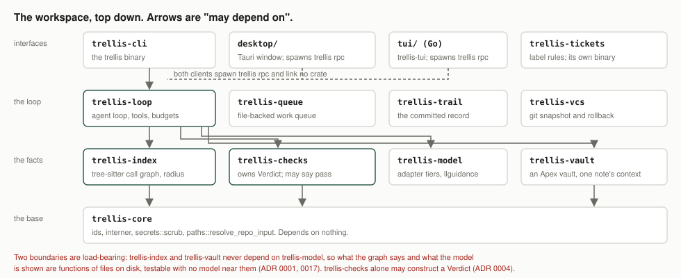
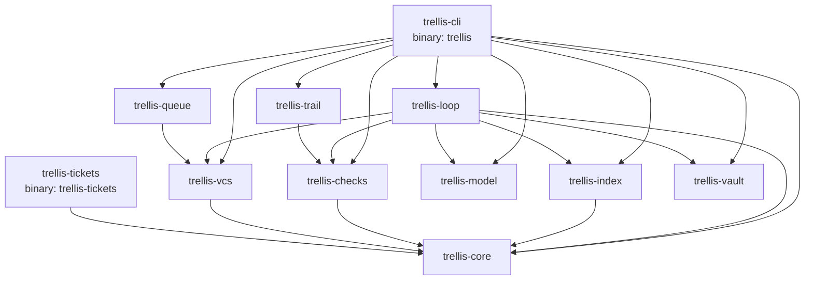
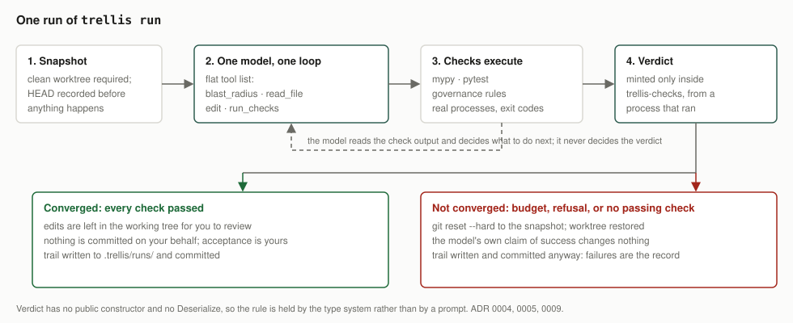

# Architecture

For an engineer new to the repository. It maps the crates and traces one
`trellis run` through the code. It does not restate the specification:
`docs/BRIEF.md` is that, `docs/MISSION.md` is the short version, and the
ADRs in `docs/adr/` hold every decision (index: `docs/adr/README.md`).
Terms are defined in `docs/GLOSSARY.md`.

## What it is

TRELLIS is a Rust agent harness for Python repositories. It builds a call
graph of a repository's first-party code with tree-sitter, drives one model
through a flat tool list against that graph, verifies every change by
running the repository's own type checker and test suite, rolls back
anything that does not converge, and commits a JSON decision trail for each
run. The graph is high-precision and explicitly incomplete, and every blast
radius carries a count of what it could not see (ADR 0002, ADR 0014). A pass
can only come from a process that ran, and that rule is held by the type
system rather than by a prompt (ADR 0004). What is built and what is not is
audited in `docs/STATUS.md`. `trellis rpc` has two clients on record: the
Tauri desktop in `desktop/`, whose overview, run, trails, codebase, board
and vault views are built (ADR 0048, story S15), and the Go TUI in `tui/`,
built and handed the terminal by `trellis --tui` when `trellis-tui` is beside
the binary (ADR 0052, #514; parity in `tui/PARITY.md`). The ratatui interface
that was the fallback for one release is retired (#516).

## Crate map

<picture>
  <source media="(prefers-color-scheme: dark)" srcset="assets/crates-dark.svg">
  
</picture>

The picture is the same information as the tables below, drawn once; the
tables are what is checked against the manifests.

"May depend on" is the workspace crates each `Cargo.toml` names under
`[dependencies]`, read on 2026-10-10. "Must never depend on" is the rule as
`CLAUDE.md` ("Crate boundaries are load-bearing") states it; a dash means
`CLAUDE.md` states no rule for that crate.

| Crate | Owns | Depends on (workspace) | Must never depend on |
|---|---|---|---|
| `trellis-core` | ids, interner, `secrets::scrub`, `paths::resolve_repo_input`, process killing | nothing | anything in the workspace |
| `trellis-index` | tree-sitter parse, resolver, call graph, `blast_radius`, `RadiusCoverage`, Pyright backstop | `trellis-core` | `trellis-model` (ADR 0001, 0017) |
| `trellis-checks` | `Verdict`, `Seal`, `ProcessOutput`, typecheck/tests/import/governance checks, `coverage.json` reading | `trellis-core` | — (it is the only crate that may assert correctness) |
| `trellis-model` | adapter tiers (`AdapterTier`), runtime and hosted HTTP clients, model specs, llguidance behind the `grammar` feature, TLS behind `hosted` | nothing | — |
| `trellis-loop` | the agent loop (`run_seeded`), the orchestrator actor, tools, gates, budgets, hooks, trust store, skills, partitioning, the integrated check | `trellis-core`, `trellis-index`, `trellis-checks`, `trellis-model`, `trellis-vault`, `trellis-vcs` | — (ADR 0029 records why it keeps `trellis-index`) |
| `trellis-trail` | `Trail`, `Factual`, `Judgment`, `ModeCounts`, `UntrustedTrail`, `RecordedCheck` | `trellis-checks` | — |
| `trellis-vcs` | `snapshot`, `Snapshot::rollback_written`, `commit_paths`, `command()`/`git_argv` | `trellis-core` | — |
| `trellis-vault` | reading, validating, searching, editing an Apex-format vault; `compile` of one focus note | nothing | `trellis-model` (ADR 0017) |
| `trellis-queue` | file-backed queue in the git dir, the heartbeat (`work`), profiles, routines, cron, approvals | `trellis-vcs` | `trellis-loop`, `trellis-model` |
| `trellis-tickets` | the ticketing standard's label rules, and the `trellis-tickets` binary | `trellis-core` | anything else (ADR 0040: "depends only on trellis-core") |
| `trellis-cli` | the `trellis` binary: argument parsing, `run_cmd`, session, rpc, work, vault, trust | every crate above except `trellis-tickets` | — |

Mismatches between `CLAUDE.md` and the manifests: none that contradict a
rule. `CLAUDE.md`'s map lists rules, not edges, so it omits
`trellis-trail → trellis-checks` and `trellis-queue → trellis-vcs`. I found
no test or script under `scripts/checks/` that fails when `trellis-index` or
`trellis-vault` gains a `trellis-model` edge; the rule is held by review.

### Dependency graph

Built from the `[dependencies]` tables only. `trellis-loop`'s
dev-dependency on `trellis-model` (with `grammar`) duplicates an existing
edge and is left out.



The same edges as a list, for grepping:

```
trellis-cli    -> core index checks model loop trail vcs vault queue
trellis-loop   -> core index checks model vault vcs
trellis-queue  -> vcs
trellis-trail  -> checks
trellis-index  -> core
trellis-checks -> core
trellis-vcs    -> core
trellis-tickets-> core
trellis-core, trellis-model, trellis-vault -> (no workspace crate)
```

`desktop/` is its own Cargo workspace with its own lock (ADR 0048 §1) and
`fuzz/` is excluded from the root workspace (`Cargo.toml`, `exclude`).

## A run from start to finish

<picture>
  <source media="(prefers-color-scheme: dark)" srcset="assets/run-dark.svg">
  
</picture>

`trellis run --model <spec> "<task>"`, single agent, no `--target`. Line
numbers drift; search for the names. Steps 8, 10 and 12 are the four boxes
and the two outcomes in the picture.

| # | Step | Where | Names |
|---|---|---|---|
| 1 | Parse arguments, set up `tracing`, find the repository root | `crates/trellis-cli/src/main.rs` | `Cli`, `Command::Run`, `main` |
| 2 | Refuse `--agents N` without `--target`; expand a prompt template; pick the model from `--model` or `.trellis/config.toml`; build `RunSeeding`, `RunControl`, `output::RunExtras` | `main.rs`, the `Command::Run` arm | `templates::task_text`, `config::RepoConfig::load`, `cmd_run_with` |
| 3 | Frame the run (JSONL brackets when `--json`) and enter the body | `crates/trellis-cli/src/run_cmd.rs` | `cmd_run_with` → `output::framed` → `run_body` |
| 4 | Parse the model spec and build the driver; probe whether the runtime honours a schema, and fall back to tier 4 if it does not | `run_cmd.rs`, `driver.rs`; `crates/trellis-model/src/spec.rs`, `tier.rs` | `trellis_model::ModelSpec`, `Driver::build` (`Driver::Scripted`/`Runtime`/`Hosted`), `probe_constraint`, `AdapterTier` |
| 5 | With `--resume`, read the newest trail back as untrusted data before anything is written | `run_cmd.rs`; `crates/trellis-trail/src/store.rs`, `untrusted.rs` | `trellis_trail::latest`, `UntrustedTrail::context_lines`, `trellis_loop::PriorContext` |
| 6 | Read context files, skills, hooks; run the `input` hook | `run_cmd.rs`, `context_files.rs`, `tooling.rs` | `repo_context`, `input_hook` |
| 7 | Multi-agent runs branch here and never take their own snapshot | `run_cmd.rs` → `run_partitioned.rs` | `run_partitioned` → `Supervisor::run_integrated` (`crates/trellis-loop/src/integrate.rs`) |
| 8 | **Snapshot.** Refuse a dirty worktree, record `HEAD`; record `.git/` config and ignored files when untrusted writers are loaded | `run_cmd.rs`; `crates/trellis-vcs/src/lib.rs`, `git_guard.rs`, `ignored.rs` | `trellis_vcs::snapshot`, `Snapshot`, `GitGuard::capture`, `IgnoredSnapshot::take` |
| 9 | Build and spawn the orchestrator actor, the only writer: governance, rules, tool set, hooks, trust guard, gates | `run_cmd.rs`; `crates/trellis-loop/src/orchestrator.rs` | `Orchestrator::new(...).with_governance/with_rules/with_tools/with_gate`, `Orchestrator::spawn` → `Handle` |
| 10 | **The loop**, raced against Ctrl-C and rpc `abort` | `run_cmd.rs`; `crates/trellis-loop/src/agent.rs` | `trellis_loop::run_seeded(task, model, handle, budget, seed)` |
| 10a | Each turn: check the budget, deliver steering, ask the model | `agent.rs` | `Budget::exceeded`, `Model::next_step` |
| 10b | The model's reply becomes a `Step` | `crates/trellis-loop/src/adapter.rs`, `wire.rs`, `registry.rs` | `RuntimeModel`/`HostedModel` implementing `Model`; `ToolCallWire::into_step`; `ToolSet::parse` |
| 10c | A `Step::Call` goes to the orchestrator, through the gates in order, then to the tool | `orchestrator.rs`; `gate.rs`; `hooks.rs` | `Handle::call_within` → `dispatch_gated` → `run_gates_and_tool` (`GovernanceGate` first, then `BashPolicyGate`, `HookGate`, `ApprovalGate`) |
| 10d | `run_checks` spawns the repository's checker; the result is a `Verdict` | `orchestrator.rs` `run_checks`; `crates/trellis-checks/src/lib.rs` | `trellis_checks::typecheck`, `run_tests`, `import_check`, `governance_audit` → `ToolResult::Checks(Verdict)` |
| 10e | `blast_radius` asks the index; the result carries `RadiusCoverage` | `orchestrator.rs` `blast_radius`; `crates/trellis-index/src/radius.rs` | `trellis_index::radius::blast_radius` → `ToolResult::Radius(RadiusReport)` |
| 10f | The loop records the turn | `agent.rs` | `Turn { verdict_passed, check_kind, radius_counts, .. }`, the `"turn"` tracing event |
| 10g | On `Step::Done`: converge only if the last check passed and the tree has not changed since, then audit governance over what the run touched | `agent.rs` | `Transcript::last_check_passed`, `pass_went_stale`, `Handle::audit_governance`, `Outcome::Converged` / `NotConverged` |
| 11 | Demote a converged run whose trust, `.git/`, worktree or `HEAD` changed under it | `run_cmd.rs` | `NotConverged::TrustChanged`, `AfterRunChangedTree`, `GitDirChanged`, `HeadMoved` |
| 12a | **Converged:** leave the edits in the working tree, write and commit the trail, print the coverage line for the files changed | `run_cmd.rs` | `record_trail`, `trellis_index::doubt_in_files`, `RunExit::Converged` |
| 12b | **Not converged:** roll back first, then write and commit the trail, so the rollback's clean cannot delete it | `run_cmd.rs`; `trellis-vcs` | `rollback_run` → `rollback_and_report` → `Snapshot::rollback_written`, `Snapshot::written_differ`; then `record_trail` |
| 13 | Exit code from the outcome | `run_cmd.rs`, `main.rs` | `RunExit::code` (0, 1, 2, 130) |

### Where the three load-bearing values are made and read

| Value | Created | Carried | Consumed |
|---|---|---|---|
| `Verdict` | only in `crates/trellis-checks/src/verdict.rs`, by `Verdict::from_typecheck`, `from_tests`, `from_import`, `from_governance` (`pub(crate)`), called from the four check functions in `trellis-checks/src/lib.rs` | `ToolResult::Checks(Verdict)` (`crates/trellis-loop/src/tools.rs`) | `run_seeded` reads `passed()` into `Turn::verdict_passed`; `Transcript::last_check_passed` decides convergence; `Supervisor::run_integrated` and `process_agent.rs` read their own; `record_trail` turns turns into `CheckOutcome`s, because `Factual::checks` (`Vec<Verdict>`) cannot be filled from outside `trellis-checks` and is written empty |
| `RadiusCoverage` | `trellis_index::radius::blast_radius` (`crates/trellis-index/src/radius.rs`), inside `RadiusReport::coverage`; there is no constructor that omits it | `ToolResult::Radius(RadiusReport)` | `agent.rs` `render_radius` (what the model reads) and `Turn::radius_counts`; `record_trail` folds the counts into `trellis_trail::RadiusCounts` (reach summed, unbound as the widest single query); `index_cmd.rs` prints it for `trellis radius` |
| The trail | `record_trail` in `crates/trellis-cli/src/run_cmd.rs` builds `Trail` with `Factual`, `Judgment`, `Provenance` and `Trail::compute_factual_sha256` | `trellis_trail::write` (`crates/trellis-trail/src/store.rs`) to `.trellis/runs/<timestamp>-<slug>.json`, then `trellis_vcs::commit_paths` commits that one file | read back only as `UntrustedTrail` (`untrusted.rs`): `trellis_trail::latest` for `--resume` and `trellis resume`, `trellis_trail::query::all` for `log` and `why` (`log_cmd.rs`), `UntrustedTrail::from_json` in `rpc.rs` and `session.rs` |

## Other entry points

| Entry point | File | Reaches the loop through | ADR |
|---|---|---|---|
| bare `trellis` | `crates/trellis-cli/src/main.rs` (`let Some(command) = cli.command else`) | at a terminal: the desktop via `launch::launch_desktop` or the TUI; on a pipe: `session::Session` | 0050 |
| `trellis session` | `crates/trellis-cli/src/session.rs` | `cmd_run_with`, holding the index between tasks | — |
| `trellis tui` | `crates/trellis-cli/src/main.rs` `terminal_ui`, handing off to `tui/` (`launch::hand_off`); refuses, naming where it looked, when no `trellis-tui` is found (#516) | `trellis rpc`'s, in `trellis-tui`'s child | 0052 |
| `trellis rpc` (desktop and TUI clients) | `crates/trellis-cli/src/rpc.rs`, `serve` | `cmd_run_with` on its own thread, once a `set_model` has given the session a model (a `prompt` before then is refused, #564); `abort`, `approve`, `steer`, `get_state` answered meanwhile | 0025 §5, 0048, 0052 |
| `trellis queue`, `trellis work` | `crates/trellis-cli/src/work.rs` (`queue`, `work`); `crates/trellis-queue/src/lib.rs` (`work`, `Runner`, `Queue`) | a `Runner` whose `run` is `cmd_run`; a process agent runs its command in a clone instead (`process_agent.rs`) | 0020, 0026 |
| `trellis agents`, `trellis routines` | `crates/trellis-cli/src/orchestrate.rs` | not at all; they list and validate profiles and routines | 0026 |
| `trellis vault` | `crates/trellis-cli/src/vault_cmd.rs` → `trellis-vault` | not at all; these are human commands, not model tools | 0022 |
| `trellis trust` | `crates/trellis-cli/src/trust_cmd.rs`, `crates/trellis-loop/src/trust.rs` | not at all; records trust in the user's store | 0023 §4 |
| `trellis index`, `radius`, `partitions` | `crates/trellis-cli/src/index_cmd.rs` | not at all | 0001, 0014, 0016 |
| `trellis-tickets` binary | `crates/trellis-tickets/src/main.rs` | not at all; spawns `gh` | 0040 |
| desktop | `desktop/` (separate workspace), launched by `launch.rs` | `trellis rpc` | 0048 |

## Invariants

From `CLAUDE.md` ("Invariants the PR #1 review rounds put in place" and
"Rules that need an ADR to change"). Each test named below was found by
name in the tree on 2026-10-10. Read the ADR before loosening any of them.

| Invariant | ADR | Held by |
|---|---|---|
| Every `git` spawn goes through `trellis_vcs::command()`/`git_argv` | [0023](adr/0023-tools-trust-and-hooks.md) | `every_git_spawn_goes_through_trellis_vcs` in `crates/trellis-cli/tests/hygiene.rs` |
| Every child process drops the provider-key variables (`trellis_core::secrets::scrub`); a process agent gets back only its `pass_env` | [0024](adr/0024-hosted-providers-and-compaction.md) §3, [0026](adr/0026-local-orchestration.md) | `every_process_spawn_in_the_workspace_removes_the_key_variables`, `a_process_agent_inherits_no_key_unless_its_profile_passes_that_one` in `crates/trellis-cli/tests/child_env.rs` |
| Repository prompt inputs go through `trellis_core::paths::resolve_repo_input` | [0025](adr/0025-context-files-and-run-modes.md) | `a_context_file_linked_outside_the_repository_is_refused_by_name` in `crates/trellis-cli/src/context_files.rs` |
| Only the user decides where a key is sent; a repository may not name `key_env` | [0024](adr/0024-hosted-providers-and-compaction.md) §3 | `a_repository_that_names_the_key_variable_is_refused_at_load`, `a_plain_run_refuses_a_hosted_endpoint_the_repository_chose` in `crates/trellis-cli/tests/hosted_keys.rs` |
| Model writes never land in `.trellis/` or `.git/`; trusted code lives under `.trellis/` | [0023](adr/0023-tools-trust-and-hooks.md) | `neither_edit_nor_write_file_can_reach_dot_trellis_by_any_spelling`, `neither_write_file_nor_edit_can_reach_git_s_own_directory_by_any_spelling` in `crates/trellis-loop/src/extension_tests.rs`; `a_hook_or_custom_tool_naming_code_outside_dot_trellis_is_refused` in `crates/trellis-loop/src/trust.rs` |
| Model writes never land in the configured vault's notes root | [0049](adr/0049-model-writes-stay-out-of-the-vault.md) | the `vault_notes_root_*` tests in `trellis-loop` (`gate.rs`, `governance.rs`, `agent_clone.rs`, `isolate.rs`); `a_model_edit_into_the_vault_is_refused_and_named` (`crates/trellis-cli/tests/note_tools.rs`); `a_process_agent_s_write_into_the_vault_is_refused_and_named` (`crates/trellis-cli/tests/orchestration.rs`) |
| A pass stops counting once the tree changes, or `HEAD` moves, or trusted code or `.git/` changes | [0004](adr/0004-grounding-contract.md), [0009](adr/0009-clean-worktree-requirement.md), [0023](adr/0023-tools-trust-and-hooks.md) | `a_pass_before_the_last_edit_does_not_count` (`crates/trellis-loop/src/agent.rs`); `a_bash_command_that_changes_dot_trellis_ends_the_run_with_no_hook_declared` (`extension_tests.rs`); `a_process_agent_that_switches_branch_is_refused_and_put_back_on_the_original` (`orchestration.rs`) |
| Rollback is complete for trellis's own writes; untrusted writers run in a throwaway clone | [0032](adr/0032-throwaway-clone-for-untrusted-writers.md), [0046](adr/0046-rollback-under-a-clock-that-steps-back.md) | the eight `rollback_*` tests CI's `rollback-gate` job names (`crates/trellis-vcs/src/lib.rs`, e.g. `rollback_after_an_induced_panic_returns_the_repo_to_its_prior_state`); `isolated_clone_keeps_gitignore_skip_worktree_and_git_dir_writes_out_of_the_repository` (`crates/trellis-loop/src/isolate.rs`) |
| 1. `Verdict` is unforgeable outside `trellis-checks` | [0004](adr/0004-grounding-contract.md) | `a_verdict_cannot_be_constructed_outside_this_crate` (`crates/trellis-checks/tests/seal.rs`, compile-fail fixtures in `tests/forge/`) |
| 2. `ToolResult` has no pass variant | [0004](adr/0004-grounding-contract.md) | `tool_result_variants_are_accounted_for`, `nothing_but_a_verdict_carries_a_passing_claim` (`crates/trellis-loop/src/tools.rs`) |
| 3. A blast radius ships with its coverage, as two facts and never a ratio | [0002](adr/0002-edge-confidence-model.md), [0014](adr/0014-radius-coverage.md) | `the_summary_states_two_facts_and_no_ratio` (`crates/trellis-index/src/radius.rs`); `radius_ships_reach_and_doubt_as_two_facts` (`crates/trellis-cli/tests/cli.rs`) |
| 4. `Verified` and `Reviewed` are never one number | [0003](adr/0003-degradation-policy.md) | `mode_counts_never_collapse_into_one_number` (`crates/trellis-trail/src/lib.rs`) |
| 5. No agent produces a verdict on another agent's output | [0005](adr/0005-loop-shape.md) | `rule5_a_partitions_own_passing_verdict_is_not_the_runs_verdict` (`crates/trellis-loop/src/integrate.rs`) |
| 6. Unresolved and candidate edges are unpartitionable; integrated checks are never skipped | [0005](adr/0005-loop-shape.md), [0042](adr/0042-integrated-check-after-partition-merge.md) | `s19_units_reached_through_uncertain_edges_share_one_conservative_partition` (`crates/trellis-loop/src/partition.rs`); `integrated_check_partition_local_passes_do_not_converge_the_run` (`integrate.rs`) |
| 7. A clean worktree is required before a run | [0009](adr/0009-clean-worktree-requirement.md) | `snapshot_refuses_a_dirty_worktree` (`crates/trellis-vcs/src/lib.rs`); `run_refuses_a_dirty_worktree_and_names_the_way_out` (`crates/trellis-cli/tests/cli.rs`) |
| 8. The user's API key never touches infrastructure we control | [0010](adr/0010-byok-and-key-handling.md) | `an_openai_protocol_run_logs_and_records_nothing_of_the_key`, `an_anthropic_protocol_run_logs_and_records_nothing_of_the_key` (`hosted_keys.rs`) |
| 9. Budgets divide across partitions; they never multiply | [0008](adr/0008-budgets.md) | `budgets_divide_across_partitions` (`crates/trellis-loop/src/budget.rs`) |
| 10. Trails read back as untrusted data | [0007](adr/0007-trail-format.md) | `judgment_is_fenced_when_fed_back_as_context` (`crates/trellis-trail/src/untrusted.rs`); `a_trail_round_trips_as_untrusted` (`store.rs`) |

One correction to carry: `CLAUDE.md` rule 1 says `Verdict` has "three
`pub(crate)` constructors". `verdict.rs` has four (`from_typecheck`,
`from_tests`, `from_governance`, `from_import`), all taking a
`ProcessOutput`. The rule's substance holds; the count is stale.
